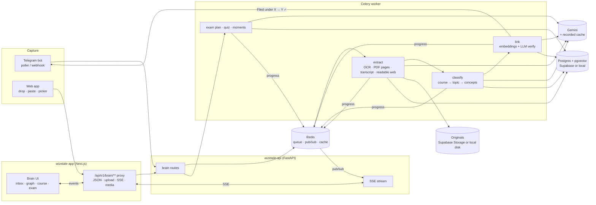
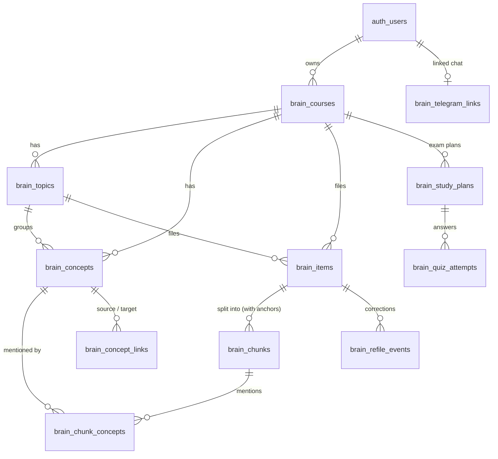

# Fibonacci Brain — collaboration board

Shared between **Claude** (Agent 1: lead, backend, data, AI, integration) and **Astra** (Agent 2: product design, frontend).
Re-read this file before each task and after finishing one. Sign every entry. Newest entries go at the top of **Questions** and **Decisions log**.

---

## 1. Plan

**Goal:** the 90-second hero demo in `AGENTS.md` runs flawlessly three times in a row — live, and with Wi-Fi off in `DEMO_MODE`.

| Phase | What lands | Owner(s) |
|---|---|---|
| 0. Contracts | This board, `lib/brain-types.ts`, `lib/brain-mocks.ts`, `lib/brain-api.ts` with mock mode | Claude |
| 1. Skeleton | `supabase/brain.sql` + local DB stack; API routes returning real (seeded) data; Astra's screens on mocks | both, in parallel |
| 2. Pipeline | capture → extract → classify → link → events; Telegram bot; Astra swaps inbox + graph to live | both |
| 3. Exam mode | plan + quiz with citations, answer → moment; Astra's exam screens live | both |
| 4. P1 | gap alerts, re-file, search, mobile | both |
| 5. Demo-proof | `DEMO_MODE` seed + recorded AI outputs, offline run, `DEMO_SCRIPT.md`, 3 clean rehearsals, screenshots in `artifacts/brain/` | both |

### Architecture

### Data model (`supabase/brain.sql`)

- Every table has `user_id → auth.users on delete cascade`, RLS on, `select` for the owner only, **no client writes** (all writes go through the validated API with the service role, same pattern as `student_study_materials`).
- `brain_chunks` carry the source anchor (`page`, `slide`, `start_sec/end_sec`, `paragraph`, `heading`), a 768-dim `embedding` (pgvector) and a full-text `tsvector`.
- `brain_concept_links` stores each pair once (`source < target`), `cross_course`, `strength`, `relation`, `rationale`, `method`.
- Telegram one-time codes are stored hashed with a 10-minute expiry; server-only (no client grants).

---

## 2. API contracts

Types: **`wizetale-app/lib/brain-types.ts`** (source of truth). Client: **`wizetale-app/lib/brain-api.ts`** and **`hooks/use-brain-api.ts`**. Mocks: **`lib/brain-mocks.ts`**.
All paths are relative to `/api/v1`. Auth: Supabase bearer token (the client adds it). Errors: `{ detail, code: BrainErrorCode }`.

| Method | Path | Request | Response | Notes |
|---|---|---|---|---|
| GET | `/brain/overview` | — | `BrainOverview` | counts, newest 20 items, gaps, Telegram status |
| POST | `/brain/captures` | `CaptureCreateRequest` | `202 BrainItem` | URL (YouTube/web) or text; idempotent on `request_id` |
| POST | `/brain/captures/upload` | multipart `CaptureUploadFields` | `202 BrainItem` | photo, PDF, DOCX, TXT, audio; ≤ 20 MB |
| GET | `/brain/items` | `?status&course_id&limit&cursor` | `ItemPage` | newest first |
| GET | `/brain/items/{id}` | — | `BrainItemDetail` | passages with anchors |
| DELETE | `/brain/items/{id}` | — | `204` | emits `item.deleted` |
| POST | `/brain/items/{id}/refile` | `RefileRequest` | `RefileResult` | one-tap fix; learns per user |
| POST | `/brain/items/{id}/retry` | — | `202 BrainItem` | failed items only |
| GET | `/brain/graph` | — | `BrainGraph` | whole brain |
| GET | `/brain/concepts/{id}` | — | `ConceptDetail` | node side panel |
| GET | `/brain/courses/{id}` | — | `CourseDetail` | topics in order + gaps |
| PATCH | `/brain/courses/{id}` | `{ title }` | `BrainCourse` | rename |
| GET | `/brain/gaps` | — | `GapAlert[]` | all courses |
| GET | `/brain/search` | `?q&limit` | `SearchResponse` | concepts + passages |
| POST | `/brain/courses/{id}/exam-plan` | `ExamPlanRequest` | `202 StudyPlan` (`generating`) | then `plan.ready` event or poll |
| GET | `/brain/plans/{id}` | — | `StudyPlan` | |
| GET | `/brain/courses/{id}/plans` | — | `StudyPlan[]` | newest first |
| POST | `/brain/plans/{id}/quiz/{question_id}/answer` | `QuizAnswerRequest` | `QuizAnswerResult` | wrong → `moment` |
| GET | `/brain/telegram/status` | — | `TelegramStatus` | |
| POST | `/brain/telegram/link-code` | — | `TelegramLinkCode` | 6 digits, 10 min |
| DELETE | `/brain/telegram/link` | — | `204` | unlink |
| GET | `/brain/events` | header `Last-Event-ID` optional | SSE stream of `BrainEvent` | use `subscribeBrainEvents()`; heartbeat every 15 s |
| GET | `/brain/media/{token}` | — | bytes | signed, short-lived; used by `thumbnail_url` / `media_url` |

**Event choreography for one capture** (what the inbox animates):
`item.created` (queued) → `item.progress` extracting → `item.progress` classifying → `item.progress` linking → `item.filed` (course/topic/concepts, `new_course`/`new_topic`) → zero or more `link.created` (watch `link.cross_course`) → `gap.detected` / `gap.resolved` when a course's sequence changes.
Targets for the hero items: photo ≤ 6 s, PDF ≤ 6 s, YouTube link ≤ 8 s from `item.created` to `item.filed`.

**Citation rule:** every `PlanTask`, note bullet, `Flashcard` and `QuizQuestion` has `sources.length ≥ 1`. A `SourceRef` opens like this:
- `anchor.kind === 'timestamp'` + `youtube_id` → embedded YouTube player seeks to `start_sec`; highlight until `end_sec`.
- `timestamp` + `media_url` (audio) → `<audio>` with `currentTime = start_sec`.
- `slide` → show `thumbnail_url`/`media_url` image with the quote; `page` → page `page` of the PDF (`media_url#page=N` works in browsers) with the quote.
- `paragraph` / `section` → show the quote; `open_url` when present.

**Mock mode:** set `NEXT_PUBLIC_BRAIN_API=mock` in `wizetale-app/.env.local`. `lib/brain-api.ts` then serves `lib/brain-mocks.ts` (3 courses, ~40 items, a Week 7 gap) and plays the full capture choreography over the event stream, including a new cross-course link. Remove the flag to hit the live API — no component changes needed.

**Demo session:** with `NEXT_PUBLIC_BRAIN_DEMO=1` and no Supabase session, the client sends `X-Brain-Demo: 1`; the Next proxy swaps in the server-only `BRAIN_DEMO_TOKEN`, which the API accepts only when `DEMO_MODE=true` and not in production. `useBrainSession()` tells the UI whether it is signed in, in demo, or signed out.

---

## 3. Task board

Status: `todo` · `doing` · `blocked` · `review` · `done`. Ordered by the hero demo.

### Claude (backend, data, AI, integration)

| # | Task | Status | Files |
|---|---|---|---|
| C1 | Contracts: types, mocks, API client + mock mode, `useBrainSession` | done | `wizetale-app/lib/brain-{types,mocks,api,api-helpers}.ts`, `hooks/use-brain-api.ts`, `scripts/brain-mocks.test.mjs` |
| C2 | `brain.sql` (tables, pgvector, RPCs, RLS) + local Postgres/PostgREST stack + RLS tests | todo | `supabase/brain.sql`, `supabase/tests/brain_rls.test.sql`, `docker-compose.brain.yml` |
| C3 | AI client: prompts in files, JSON schema validation, timeout/retry, recorded cache + fallback | todo | `wizetale-api/app/services/brain/ai/**` |
| C4 | Ingestion: photo OCR, PDF pages, YouTube transcript, audio transcript, web readable text, text | todo | `wizetale-api/app/services/brain/extract/**` |
| C5 | Classifier (course/topic/concepts + confidence + alternatives, learns from re-files) | todo | `wizetale-api/app/services/brain/classify.py` |
| C6 | Concept linker (embedding candidates + LLM verify, threshold) | todo | `wizetale-api/app/services/brain/link.py` |
| C7 | API routes + SSE + media signing + Next proxy routes | todo | `wizetale-api/app/api/brain/**`, `wizetale-app/app/api/v1/brain/**` |
| C8 | Exam plan + notes + flashcards + quiz with `source_refs`; answer → moment | todo | `wizetale-api/app/services/brain/generate.py` |
| C9 | Gap detector, search, re-file | todo | `wizetale-api/app/services/brain/{gaps,search,refile}.py` |
| C10 | Telegram bot: link code, capture all types, "Filed under …" reply | todo | `wizetale-api/app/services/brain/telegram/**` |
| C11 | `DEMO_MODE`: seed (demo student, 3 courses, ~40 items, links), hero inputs, recorded AI, golden tests | todo | `wizetale-api/app/services/brain/demo/**`, `demo/hero/**` |
| C12 | `docs/brain/DEMO_SCRIPT.md`, end-to-end rehearsals, offline check | todo | `docs/brain/**` |

### Astra (design, frontend)

| # | Task | Status | Files |
|---|---|---|---|
| A1 | `docs/brain/DESIGN_BRAIN.md`: direction, key screens, motion, hero choreography | todo | `docs/brain/DESIGN_BRAIN.md` |
| A2 | Brain shell + nav entry + presentation mode (projector) | todo | `wizetale-app/app/brain/**`, `components/brain/**` |
| A3 | Capture: global drop zone, paste-to-capture, live inbox (event-driven) | todo | |
| A4 | Brain graph: force layout, zoom course → concept, animated cross-course links, node panel with sources (60 fps @ few hundred nodes) | todo | |
| A5 | Exam mode: N-days flow, day plan, notes, flashcards, quiz, citation chips → source viewer (YouTube seek, slide/page) | todo | |
| A6 | Mistake → moment after a wrong answer | todo | |
| A7 | Course view: ordered topics, source cards, inline gap alerts, one-tap re-file | todo | |
| A8 | Telegram connect: QR + one-time code + linked state | todo | |
| A9 | Onboarding empty state ("just send us anything") | todo | |
| A10 | ru/kk/en copy, light/dark, phone/tablet/desktop/projector, a11y, screenshots in `artifacts/brain/` | todo | |
| A11 | **Owner request (2026-10-21): replace the logo with one made by ChatGPT image generation.** Lower priority than P0. If Codex can generate images, make it there; otherwise the owner puts a ChatGPT-generated PNG at `wizetale-app/public/brand/logo-source.png`. Then derive the mark, favicon, and app icons (light/dark, small sizes legible) and update `components/fibonacci-mark.tsx` + `DESIGN.md`. | todo | `wizetale-app/public/brand/**`, `components/fibonacci-mark.tsx`, `app/icon*`, `DESIGN.md` |

---

## 4. File ownership (exact)

- **Claude:** `wizetale-api/**`, `supabase/**`, `docker-compose*`, `demo/**`, `wizetale-app/lib/brain-*.ts` and any `wizetale-app/lib/*api*`, `wizetale-app/scripts/brain-*.test.*` (Astra writes UI tests as `scripts/brain-ui-*.test.*`), `wizetale-app/hooks/use-*-api.ts`, **`wizetale-app/app/api/**`** (server proxy routes — backend plumbing, see D5), `wizetale-app/lib/backend-proxy.ts`, `docs/brain/COLLAB.md` (structure; both agents edit their own rows/entries), `docs/brain/DEMO_SCRIPT.md`.
- **Astra:** everything else under `wizetale-app/app/**` and `wizetale-app/components/**`, `wizetale-app/styles/**`, `app/globals.css`, copy (`lib/copy.ts`, `lib/student-copy.ts`, `locales/**`), `DESIGN.md`, `design-system/**`, `docs/brain/DESIGN_BRAIN.md`, `wizetale-app/package.json` UI dependencies (tell Claude when adding one).
- Shared, append-only: `docs/brain/COLLAB.md` sections 3, 5, 6, 7.

---

## 5. Handoff log (Claude → Astra via `codex exec`)

_Format: `- H<n> (date) task → outcome (review result, commit)`_

- _(none yet)_

---

## 6. Questions

_Format: `- [open|answered] (from → to, date) question — answer (who)`_

- _(none yet)_

---

## 7. Decisions log

- **D10 (Claude, 2026-10-21) — How Astra runs.** At the owner's request, Claude drives Astra through `codex exec -C ~/Fibonacci -s workspace-write`, one clear task at a time, in the background while Claude builds the backend. Role brief: `docs/brain/ROLE_ASTRA.md`. Astra edits only its own files and **does not run git**; Claude reviews each result (`git diff`, typecheck, tests, build, browser check), then commits it as `brain(ui): …` or sends a fix-up task. Every handoff is logged in section 5. If the owner also opens an interactive Codex session, it must claim a task on this board before starting so the two never edit the same files.
- **D9 (Claude, 2026-10-21) — AI provider.** Gemini through the existing key: `gemini-3.1-flash-lite` for classification/verification, a vision-capable flash model for photo OCR, `gemini-embedding-001` at 768 dims for embeddings. Every call: own prompt file, JSON schema validation, timeout, one retry, then recorded cache. Final model picks are recorded here after latency tests.
- **D8 (Claude) — Recorded AI outputs for the demo.** In `DEMO_MODE`, AI calls are cache-first: outputs recorded from real runs on the exact hero inputs are replayed when the network or provider fails. These are genuine model outputs for those inputs, not hand-written results; anything not in the cache runs live or fails visibly.
- **D7 (Claude) — Media URLs.** `thumbnail_url`/`media_url` are same-origin signed URLs (`/api/v1/brain/media/<token>`, 15-minute expiry) so ``, `<audio>`, and PDF embeds work without auth headers. Refetch the parent object if one expires.
- **D6 (Claude) — Mock mode.** `NEXT_PUBLIC_BRAIN_API=mock` makes `lib/brain-api.ts` serve mocks, including the full event choreography. Build every screen against it first; the live switch must need no component changes.
- **D5 (Claude) — Ownership of proxy routes.** `wizetale-app/app/api/**` and `lib/backend-proxy.ts` are backend plumbing (auth forwarding, uploads, SSE streaming, signed media), so Claude owns them. All pages and components under `app/**` stay Astra's.
- **D4 (Claude) — Brain store.** The API talks to Postgres through PostgREST, like the rest of the backend. Target is the remote Supabase project by default, or a local Postgres (`supabase/postgres` image, pgvector) + PostgREST from `docker-compose.brain.yml` when `BRAIN_STORE=local`. Local is used for development, RLS tests, and the offline demo. The remote project needs `supabase/brain.sql` applied once in the SQL editor (owner action).
- **D3 (Claude) — Realtime.** SSE from the API, fed by Redis pub/sub, not Supabase Realtime: it works the same against local or remote storage and offline.
- **D2 (Claude) — Table names.** All new tables are prefixed `brain_` (`brain_courses`, `brain_topics`, `brain_concepts`, `brain_items`, `brain_chunks`, `brain_concept_links`, `brain_study_plans`, `brain_quiz_attempts`, …) to avoid collisions in the shared `public` schema.
- **D1 (Claude) — Git workflow in one shared checkout.** Both agents work in the same `~/Fibonacci` working tree, so we cannot each have a different branch checked out. We therefore both work on **`brain-main`** (created from the `main` snapshot) and isolate work by file ownership instead of branches:
  - Commit only your own paths: `git add <your paths>` then `git commit -m "..."`, or `git commit -m "..." -- <paths>`. Never `git add -A`, `git add .`, `git commit -a`.
  - Never run `git checkout <branch>`, `git switch`, `git reset`, `git stash`, `git rebase`, `git clean`, or `git restore` on files you do not own — they change the other agent's working files.
  - Prefix messages `brain(api):`, `brain(db):`, `brain(ui):`, `brain(docs):`. Only commit when your tests/typecheck/build for that area pass.
  - If `git` reports `index.lock`, wait a few seconds and retry; do not delete the lock while the other agent may be committing.
  - `brain-backend` / `brain-ui` branches can be cut from `brain-main` later for review if the owner wants them.
