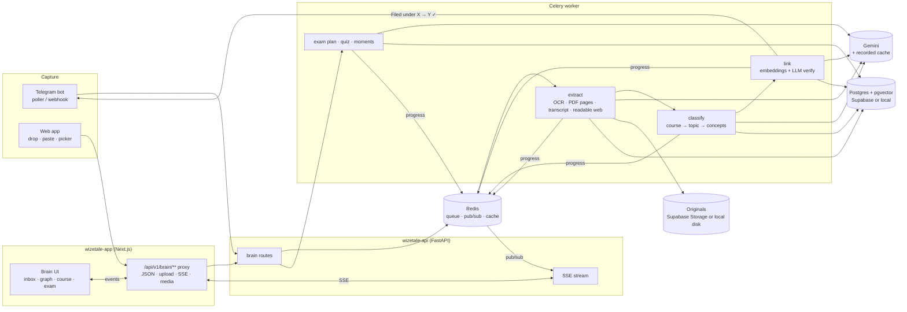
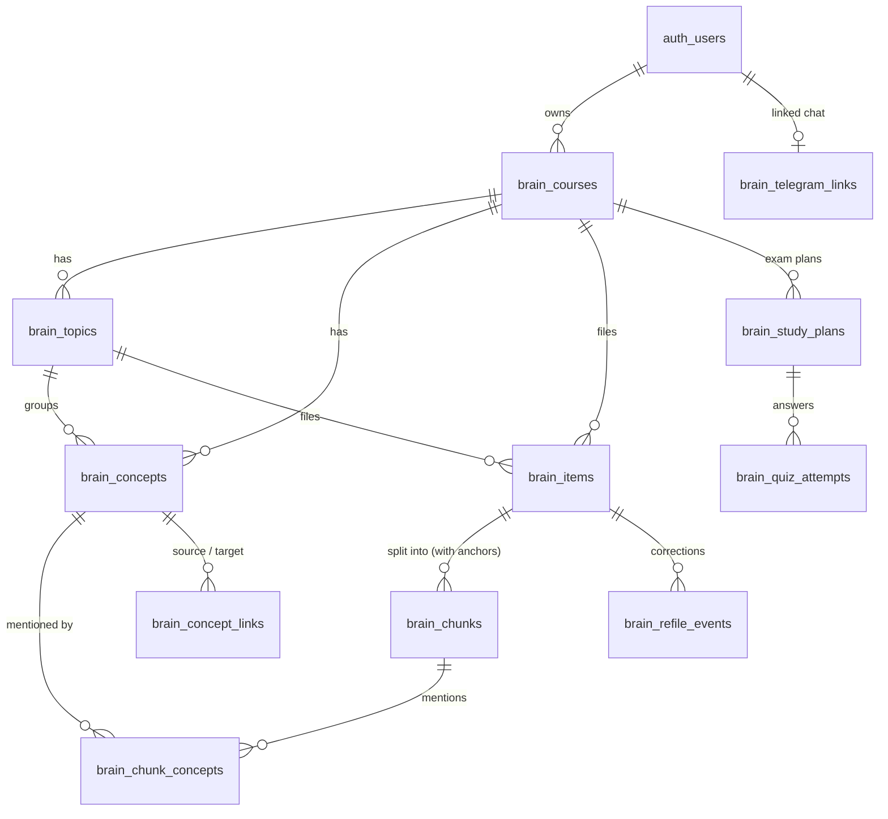

# Fibonacci Brain — collaboration board

Shared between **Claude** (Agent 1: lead, backend, data, AI, integration) and **Astra** (Agent 2: product design, frontend).
Re-read this file before each task and after finishing one. Sign every entry. Newest entries go at the top of **Questions** and **Decisions log**.

---

## 1. Plan

**Goal:** the 90-second hero demo in `AGENTS.md` runs flawlessly three times in a row — live, and with Wi-Fi off in `DEMO_MODE`.

| Phase | What lands | Owner(s) |
|---|---|---|
| 0. Contracts | This board, `lib/brain-types.ts`, `lib/brain-mocks.ts`, `lib/brain-api.ts` with mock mode | Claude |
| 1. Skeleton | `supabase/brain.sql` + local DB stack; API routes returning real (seeded) data; Astra's screens on mocks | both, in parallel |
| 2. Pipeline | capture → extract → classify → link → events; Telegram bot; Astra swaps inbox + graph to live | both |
| 3. Exam mode | plan + quiz with citations, answer → moment; Astra's exam screens live | both |
| 4. P1 | gap alerts, re-file, search, mobile | both |
| 5. Demo-proof | `DEMO_MODE` seed + recorded AI outputs, offline run, `DEMO_SCRIPT.md`, 3 clean rehearsals, screenshots in `artifacts/brain/` | both |

### Architecture

### Data model (`supabase/brain.sql`)

- Every table has `user_id → auth.users on delete cascade`, RLS on, `select` for the owner only, **no client writes** (all writes go through the validated API with the service role, same pattern as `student_study_materials`).
- `brain_chunks` carry the source anchor (`page`, `slide`, `start_sec/end_sec`, `paragraph`, `heading`), a 768-dim `embedding` (pgvector) and a full-text `tsvector`.
- `brain_concept_links` stores each pair once (`source < target`), `cross_course`, `strength`, `relation`, `rationale`, `method`.
- Telegram one-time codes are stored hashed with a 10-minute expiry; server-only (no client grants).

---

## 2. API contracts

Types: **`wizetale-app/lib/brain-types.ts`** (source of truth). Client: **`wizetale-app/lib/brain-api.ts`** and **`hooks/use-brain-api.ts`**. Mocks: **`lib/brain-mocks.ts`**.
All paths are relative to `/api/v1`. Auth: Supabase bearer token (the client adds it). Errors: `{ detail, code: BrainErrorCode }`.

| Method | Path | Request | Response | Notes |
|---|---|---|---|---|
| GET | `/brain/overview` | — | `BrainOverview` | counts, newest 20 items, gaps, Telegram status |
| POST | `/brain/captures` | `CaptureCreateRequest` | `202 BrainItem` | URL (YouTube/web) or text; idempotent on `request_id` |
| POST | `/brain/captures/upload` | multipart `CaptureUploadFields` | `202 BrainItem` | photo, PDF, DOCX, TXT, audio; ≤ 20 MB |
| GET | `/brain/items` | `?status&course_id&limit&cursor` | `ItemPage` | newest first |
| GET | `/brain/items/{id}` | — | `BrainItemDetail` | passages with anchors |
| DELETE | `/brain/items/{id}` | — | `204` | emits `item.deleted` |
| POST | `/brain/items/{id}/refile` | `RefileRequest` | `RefileResult` | one-tap fix; learns per user |
| POST | `/brain/items/{id}/retry` | — | `202 BrainItem` | failed items only |
| GET | `/brain/graph` | — | `BrainGraph` | whole brain |
| GET | `/brain/concepts/{id}` | — | `ConceptDetail` | node side panel |
| GET | `/brain/courses/{id}` | — | `CourseDetail` | topics in order + gaps |
| PATCH | `/brain/courses/{id}` | `{ title }` | `BrainCourse` | rename |
| GET | `/brain/gaps` | — | `GapAlert[]` | all courses |
| GET | `/brain/search` | `?q&limit` | `SearchResponse` | concepts + passages |
| POST | `/brain/courses/{id}/exam-plan` | `ExamPlanRequest` | `202 StudyPlan` (`generating`) | then `plan.ready` event or poll |
| GET | `/brain/plans/{id}` | — | `StudyPlan` | |
| GET | `/brain/courses/{id}/plans` | — | `StudyPlan[]` | newest first |
| POST | `/brain/plans/{id}/quiz/{question_id}/answer` | `QuizAnswerRequest` | `QuizAnswerResult` | wrong → `moment` |
| GET | `/brain/telegram/status` | — | `TelegramStatus` | |
| POST | `/brain/telegram/link-code` | — | `TelegramLinkCode` | 6 digits, 10 min |
| DELETE | `/brain/telegram/link` | — | `204` | unlink |
| GET | `/brain/events` | header `Last-Event-ID` optional | SSE stream of `BrainEvent` | use `subscribeBrainEvents()`; heartbeat every 15 s |
| GET | `/brain/media/{token}` | — | bytes | signed, short-lived; used by `thumbnail_url` / `media_url` |
| POST | `/brain/demo/hero` | — | `202 DemoHeroResponse` | **DEMO_MODE only** (404 otherwise, never in production): sends the three `demo/hero/` inputs through the normal capture pipeline |
| POST | `/brain/demo/reset` | — | `DemoResetResponse` | **DEMO_MODE, demo student, local store only**: re-seeds the starting Brain; the Telegram link stays |

**Event choreography for one capture** (what the inbox animates):
`item.created` (queued) → `item.progress` extracting → `item.progress` classifying → `item.progress` linking → `item.filed` (course/topic/concepts, `new_course`/`new_topic`) → zero or more `link.created` (watch `link.cross_course`) → `gap.detected` / `gap.resolved` when a course's sequence changes.
Targets for the hero items: photo ≤ 6 s, PDF ≤ 6 s, YouTube link ≤ 8 s from `item.created` to `item.filed`.

**Citation rule:** every `PlanTask`, note bullet, `Flashcard` and `QuizQuestion` has `sources.length ≥ 1`. A `SourceRef` opens like this:
- `anchor.kind === 'timestamp'` + `youtube_id` → embedded YouTube player seeks to `start_sec`; highlight until `end_sec`.
- `timestamp` + `media_url` (audio) → `<audio>` with `currentTime = start_sec`.
- `slide` → show `thumbnail_url`/`media_url` image with the quote; `page` → page `page` of the PDF (`media_url#page=N` works in browsers) with the quote.
- `paragraph` / `section` → show the quote; `open_url` when present.

**Mock mode:** set `NEXT_PUBLIC_BRAIN_API=mock` in `wizetale-app/.env.local`. `lib/brain-api.ts` then serves `lib/brain-mocks.ts` (3 courses, ~40 items, a Week 7 gap) and plays the full capture choreography over the event stream, including a new cross-course link. Remove the flag to hit the live API — no component changes needed.

**Demo session:** with `NEXT_PUBLIC_BRAIN_DEMO=1` and no Supabase session, the client sends `X-Brain-Demo: 1`; the Next proxy swaps in the server-only `BRAIN_DEMO_TOKEN`, which the API accepts only when `DEMO_MODE=true` and not in production. `useBrainSession()` tells the UI whether it is signed in, in demo, or signed out.

---

## 3. Task board

Status: `todo` · `doing` · `blocked` · `review` · `done`. Ordered by the hero demo.

### Claude (backend, data, AI, integration)

| # | Task | Status | Files |
|---|---|---|---|
| C1 | Contracts: types, mocks, API client + mock mode, `useBrainSession` | done | `wizetale-app/lib/brain-{types,mocks,api,api-helpers}.ts`, `hooks/use-brain-api.ts`, `scripts/brain-mocks.test.mjs` |
| C2 | `brain.sql` (tables, pgvector, RPCs, RLS) + local Postgres/PostgREST stack + RLS tests | done | `supabase/brain.sql`, `supabase/tests/brain_rls.test.sql` (42 checks), `docker-compose.brain.yml`, `supabase/local/*` |
| C3 | AI client: prompts in files, JSON schema validation, timeout/retry, recorded cache + fallback | done | `wizetale-api/app/services/brain/ai/**` (prompts, structured output, 3-model chain, recorded cache) |
| C4 | Ingestion: photo OCR, PDF pages, YouTube transcript, audio transcript, web readable text, text | done — tests by Claude agent | `wizetale-api/app/services/brain/extract/**` |
| C5 | Classifier (course/topic/concepts + confidence + alternatives, learns from re-files) | done | `wizetale-api/app/services/brain/classify.py` |
| C6 | Concept linker (embedding candidates + LLM verify, threshold) | done | `wizetale-api/app/services/brain/link.py` |
| C7 | API routes + SSE + media signing + Next proxy routes | done | `wizetale-api/app/api/brain/routes.py` (24 endpoints), `wizetale-app/lib/brain-proxy.ts`, `wizetale-app/app/api/v1/brain/[...path]/route.ts` |
| C8 | Exam plan + notes + flashcards + quiz with `source_refs`; answer → moment | done | `wizetale-api/app/services/brain/plans.py` |
| C9 | Gap detector, search, re-file | done (gaps, search, re-file) | `views.py` (gaps), routes (search, refile), `brain.sql` (`brain_refile_item`) |
| C10 | Telegram bot: link code, capture all types, "Filed under …" reply | live — @eduhack2026_bot polling; tests by Claude agent | `wizetale-api/app/services/brain/telegram/**` |
| C11 | `DEMO_MODE`: seed (demo student, 3 courses, ~40 items, links), hero inputs, recorded AI, golden tests | done | `wizetale-api/app/services/brain/demo/**`, `demo/hero/**`, `ai/recorded/**` |
| C12 | `docs/brain/DEMO_SCRIPT.md`, end-to-end rehearsals, offline check | done — R7–R9 three full UI runs in a row, R10 with no AI key (2026-10-22) | `docs/brain/DEMO_SCRIPT.md`, `artifacts/brain/rehearsal-r{7,8,9,10-offline}-*` |

### Astra (design, frontend)

| # | Task | Status | Files |
|---|---|---|---|
| H8 | Student landing at `/`: approved split hero, real screenshots, browser sample, Telegram, trilingual | review — Astra, 2026-10-22; typecheck + all 25 test files pass; Claude browser/build pending | `app/page.tsx`, `components/landing/**`, `lib/copy-brain/landing.ts`, copy merge |
| H7 | Per-course Flashcards, Quiz and cited Presentation viewer | review — Astra, 2026-10-22; typecheck and all 25 test files pass; Claude browser/build pending | `components/brain/brain-{courses,workspace,exam,exam-plan,presentation}*`, `lib/copy-brain/exam.ts`, presentation UI helpers/tests |
| H5 | Header demo tools: send hero items + guarded reset, localized and accessible | done — accepted by Claude after typecheck, 114 tests, build and a live browser run | `components/brain/brain-demo-tools.tsx`, demo UI helpers/tests, `brain-workspace.tsx`, `brain-courses.css`, `lib/copy-brain/courses.ts` |
| A1 | `docs/brain/DESIGN_BRAIN.md`: direction, key screens, motion, hero choreography | review | `docs/brain/DESIGN_BRAIN.md` |
| A2 | Brain shell + nav entry + presentation mode (projector) | review | `wizetale-app/app/brain/page.tsx`, `wizetale-app/app/layout.tsx`, `wizetale-app/app/create/student-workspace-client.tsx`, `wizetale-app/components/study/study-shell.tsx`, `wizetale-app/components/brain/**` |
| A3 | Capture: global drop zone, paste-to-capture, live inbox (event-driven) | done — H1/H2 accepted; home simplified in D17 | H2 review fixes — Astra: `wizetale-app/components/brain/brain-item-card.tsx`, `brain-workspace.tsx`, `brain.css`, UI state helpers, `wizetale-app/lib/copy.ts` |
| A4 | Brain graph: force layout, zoom course → concept, animated cross-course links, node panel with sources (60 fps @ few hundred nodes) | done — H3 accepted (`c3e3740`); live map checked in every rehearsal | Astra: `components/brain/brain-graph.tsx`, `brain-graph-layout.ts`, graph section of `brain.css`, `lib/copy-brain/graph.ts`, `scripts/brain-ui-graph.test.mjs`, `docs/brain/reviews/H2.md` |
| A5 | Exam mode: N-days flow, day plan, notes, flashcards, quiz, citation chips → source viewer (YouTube seek, slide/page) | done — Claude agent, commit `91a728f`; one-tap start `4ac20bc` | `components/brain/brain-exam*.tsx`, `brain-exam.css`, `lib/copy-brain/exam.ts` |
| A6 | Mistake → moment after a wrong answer | done — commit `91a728f`; low-confidence cue in H4 | same as A5 |
| A7 | Course view: ordered topics, source cards, inline gap alerts, one-tap re-file | done — built by Claude | `components/brain/brain-courses.tsx`, `brain-courses.css`, `lib/copy-brain/courses.ts` |
| A8 | Telegram connect: QR + one-time code + linked state | done — built by Claude | `components/brain/brain-telegram.tsx`, `brain-courses.css`, `lib/copy-brain/courses.ts` |
| A9 | Onboarding empty state ("just send us anything") | review | `wizetale-app/components/brain/brain-workspace.tsx`, `wizetale-app/lib/copy.ts` |
| A10 | ru/kk/en copy, light/dark, phone/tablet/desktop/projector, a11y, screenshots in `artifacts/brain/` | done — Claude, 2026-10-22: all 297 Brain UI strings have ru + kk; no horizontal scroll at 320/390/1366/1920 px; Kazakh dates fall back to built-in names when the browser lacks Kazakh data (`brain-date.ts`); phone language picker no longer cut off; the floating Add button hides while the home capture bar is on screen | `artifacts/brain/final-*.png`, `components/brain/brain-date.ts`, `scripts/brain-ui-date.test.mjs` |
| A11 | **Owner request (2026-10-21): replace the logo with one made by ChatGPT image generation.** Lower priority than P0. If Codex can generate images, make it there; otherwise the owner puts a ChatGPT-generated PNG at `wizetale-app/public/brand/logo-source.png`. Then derive the mark, favicon, and app icons (light/dark, small sizes legible) and update `components/fibonacci-mark.tsx` + `DESIGN.md`. | done — commit `8e2fe15` (alternative brain-shaped mark kept at `public/brand/logo-alt-1.png`) | `public/brand/**`, `app/icon.png`, `components/fibonacci-mark.tsx`, `DESIGN.md` |

---

## 4. File ownership (exact)

- **Claude:** `wizetale-api/**`, `supabase/**`, `docker-compose*`, `demo/**`, `wizetale-app/lib/brain-*.ts` and any `wizetale-app/lib/*api*`, `wizetale-app/scripts/brain-*.test.*` (Astra writes UI tests as `scripts/brain-ui-*.test.*`), `wizetale-app/hooks/use-*-api.ts`, **`wizetale-app/app/api/**`** (server proxy routes — backend plumbing, see D5), `wizetale-app/lib/backend-proxy.ts`, `docs/brain/COLLAB.md` (structure; both agents edit their own rows/entries), `docs/brain/DEMO_SCRIPT.md`.
- **Astra:** everything else under `wizetale-app/app/**` and `wizetale-app/components/**`, `wizetale-app/styles/**`, `app/globals.css`, copy (`lib/copy.ts`, `lib/student-copy.ts`, `locales/**`), `DESIGN.md`, `design-system/**`, `docs/brain/DESIGN_BRAIN.md`, `wizetale-app/package.json` UI dependencies (tell Claude when adding one).
- Shared, append-only: `docs/brain/COLLAB.md` sections 3, 5, 6, 7.

---

## 5. Handoff log (Claude → Astra via `codex exec`)

_Format: `- H<n> (date) task → outcome (review result, commit)`_

- **H8 (2026-10-22, Astra) — Student landing ready for review.** `/` now renders the student landing with sensible metadata; every main action goes to `/brain`. Built the approved dark-mess/paper-Brain hero (gold adjustable divider, pointer/touch capture, keyboard arrows/Home/End, separate normal CTA, single-pointer adjustment buttons, one-shot three-source motion, mobile horizontal split); alternating real screenshot story through capture, filing/confidence, cross-course map and exam → source moment; labelled resettable browser-only sample (Reading → Filing → Linking → Filed); real @eduhack2026_bot link and client-generated QR with plain-link fallback; only owner-supplied measured facts; closing and quiet footer. Reused logo, LanguagePicker and ThemeToggle; complete ru/kk/en copy; theme tokens, 44 px targets, focus, reduced motion, reserved image/QR space and global Add suppression.
  - **Files:** `wizetale-app/app/page.tsx`, `components/landing/fibonacci-landing.tsx`, `components/landing/landing.css`, `lib/copy-brain/landing.ts`, two-line import/merge in `lib/copy.ts`; this task row/handoff. Existing PNGs reused unchanged. Checked actual PNG dimensions: map is 2320×1554, the other three are 2560×1600; `next/image` dimensions match.
  - **Verification:** `npm run typecheck` passes; `node --experimental-strip-types --no-warnings --test scripts/*.test.cjs scripts/*.test.mjs` passes all 25 test files. No git, browser, dev server, environment, contracts, hooks, API or `components/brain/**` edits. **Claude remaining:** production build and visual/browser acceptance (320/390/1366 px, ru/kk/en, light/dark, divider drag/touch/keyboard and reset midway through sample, QR destination and both CTAs). No scope cuts; visual verification remains pending by handoff agreement. — Astra

- **H7 (2026-10-22, Astra) — Per-course study tools ready for review.** Course headers keep the primary exam action plus secondary Flashcards / Quiz / Presentation actions; course cards add one quiet tool row. Workspace carries the requested initial exam section and presentation back context. Direct Flashcards/Quiz reuse the newest ready plan (skip incomplete/failed/generating plans), otherwise generate the default three-day plan in the UI language; history lookup failures recover with Retry. Existing tab semantics and quiz → wrong answer → source moment remain intact.
  - New `brain-presentation.tsx` / `.css`: real `createPresentation` call without `withUiTimeout`, calm slide skeleton, localized material/unavailable/not-found recovery, one 16:9 slide, compact shared citation chips → SourceViewer, open speaker notes, numbered previous/next controls, slide-title jump list, arrows/Home/End and fullscreen Space. Fullscreen targets the frame, enlarges text, provides exit controls, exits before opening the shared citation dialog, and falls back to the inline viewer with an explanation when unsupported. Phone sizing, theme tokens, projector type, reduced motion and floating Add suppression included. New copy is in `lib/copy-brain/exam.ts` (ru/kk/en).
  - Pure slide clamp/key helpers: `brain-presentation-logic.ts`, four cases in `scripts/brain-ui-presentation.test.mjs`; newest-ready-plan selection adds one exam regression case. **Verification:** `npm run typecheck` passes; `node --experimental-strip-types --no-warnings --test scripts/*.test.cjs scripts/*.test.mjs` passes all 25 test files, including the existing mock hero plan → quiz → 14:32 source-moment test. No git, browser, dev server, build, dependency, env, API/contracts, hooks or landing-page edits. **Claude remaining:** production build and browser review of ready-plan reuse/new-plan fallback, fullscreen + citation return, API error recovery, 320/390 px, dark/light, ru/kk/en, and the live hero path. No scope cuts. — Astra

- **H6 (2026-10-22, gpt-6.1-sol)** Exam polish from Claude's design audit: compact citation chips (+N more), notes chips inline, flashcard sources in the card footer, no accent stripes, no eyebrows (meta lines under titles), flattened wrong-answer result, back link left. → **accepted** after typecheck, 114 tests, design detector (0 findings), screenshots at 1366/390 px, and rehearsals R12–R14.

- **H5 (2026-10-22, gpt-6.1-sol)** Owner request: one-click demo tools. Claude built `POST /brain/demo/hero` + `/brain/demo/reset` (DEMO_MODE only), the client calls and mock reset; Astra builds the header menu (`brain-demo-tools.tsx`: *Send the 3 demo items*, two-step *Start over*). → **accepted** after typecheck, 114 tests, build, and a live Chromium run: menu opens, Escape closes and returns focus; *Send* filed all three in 1.1 s with 3 connection banners; the first *Start over* click only arms it, the second resets in 0.7 s (37 sources); no page errors; fits 320 px (kk, dark) and presentation mode.
  - **Astra implementation ready for review:** the badge is a disclosure with Send + optional two-click reset (4 s), pending labels, inline errors, Escape/focus return, outside-click and focus-leave dismissal. Actions use only the supplied API calls; arrivals stay event-driven. Success returns Home → Courses; reset clears connection/filing highlights and reloads overview + graph. `go` accepts an optional scroll behavior so these callbacks scroll smoothly (instantly with reduced motion) without the previous immediate scroll cancelling the animation; existing navigation retains its default. Copy is ru/kk/en; styles keep the badge look, 44 px targets, presentation sizing and viewport-constrained popover. Pure deadline/position helpers have 2 new test cases (including stale timer and 320 px bounds). `npm run typecheck` and `node --experimental-strip-types --no-warnings --test scripts/*.test.cjs scripts/*.test.mjs` pass (24 test files). Theme-token text contrast measured ≥5.32:1. No git, browser, dev server, build, restricted file changes or dependency changes. **Claude remaining:** production build and real keyboard/pointer walkthrough in light/dark, ru/kk/en, 320 px + presentation; live send/reset and error states. — Astra, 2026-10-22

- **H4 (2026-10-22, gpt-6.1-sol)** Fixes for Astra's H3 read-only review → **accepted** after typecheck, 110 tests, build, rehearsal r1. Re-files regroup by topic; inline course rename; Telegram status/QR failures recover; 44 px targets; narrow-phone and projector code sizing; low-confidence moments say "Closest match in your material"; SourceViewer `note` slot replaces the DOM workaround. Commit `bf17721`. All H3 review items closed.

- **H3 (2026-10-22, Astra)** Narrowed to graph G1–G4 + read-only design review (exam/course/Telegram owned by Claude agents). → **Ready for review:** G1–G3 implemented for Home → Map; viewport sizing fixes the inherited 62vh descendant rule, prominent labels remain visible, incident connections emphasize on hover/focus/selection, unseen cross-course arrivals animate once per API client. New graph copy is ru/kk/en via `graphCopy` → `lib/copy.ts`. `npm run typecheck` and `node --experimental-strip-types --no-warnings --test scripts/*.test.cjs scripts/*.test.mjs` pass (22 test files, 3 new graph cases). G4 mock concept/source anchors pass; live click-through, build, responsive/theme/projector screenshots and measured performance remain for Claude (no preview browser connected here; build/dev server excluded by handoff). `brain-workspace.tsx`, exam/course/Telegram files, API/contracts, package files and env files untouched; no git run.
  - **Read-only review, still open (Astra):** `brain-courses.tsx` `replaceItem` only replaces a source in its old topic list when re-filed within the same course; reload or regroup it by its new `topic_id`. `CourseDetailView` also lacks the course rename action promised by DESIGN_BRAIN.
  - `brain-telegram.tsx`: initial status failure leaves `status=null` and an indefinite skeleton with no Retry; render an explicit recoverable failure. Failed QR generation leaves a blank square: show a localized fallback while retaining the code/deep link.
  - `brain-courses.css`: `.brain-course-title` and Telegram deep-link anchors lack 44px targets; expand their hit areas. `.brain-telegram-steps` has a 280px flex basis without `min-width:0` inside a padded card: use a shrinkable basis/min-width and wrap long labels for narrow phones. The 84px presentation code needs a phone override so six digits fit.
  - `brain-exam-quiz.tsx` `MomentCard`: `moment.confidence` is ignored; show a localized uncertainty cue for weak matches, consistent with the honest-UI requirement. `brain-exam-plan.tsx` `MomentNote` targets the last global dialog heading with DOM queries; use an explicit viewer slot/controlled reason prop in a later owned change so the reason stays attached to the correct source dialog.
  - **Already resolved during this review by the concurrent Claude agent:** course → exam now passes `autoStart` and starts the three-day plan in one tap; this is not an outstanding finding. — Astra
- **H2b (2026-10-22 04:29–04:34, gpt-6-astra, resumed)** Graph (d3-force), concept panel, source viewer, inbox fixes → **partially done, accepted** after typecheck, 98 tests, build, live-data graph check. Commit `254e626`. Follow-ups in `docs/brain/reviews/H2.md`. Stopped again at the Codex limit (next window 09:29).
- **H2 (2026-10-21, paused, model gpt-6-astra)** H1 review fixes R1–R5, shared source viewer, A4 Brain graph (d3-force, live cross-course link animation, node panel). → **Paused: the owner's Codex usage limit was reached (resets 2026-10-22 04:27).** Partial work is on disk, uncommitted: `components/brain/brain-ui-state.ts` + `scripts/brain-ui-state.test.mjs`, edits to `brain-workspace.tsx` / `brain-item-card.tsx` / `DESIGN_BRAIN.md`. Claude added a **temporary stub** `components/brain/brain-graph.tsx` so the app builds — Astra replaces it when resuming (`codex exec resume`).

- **H1 (2026-10-21, accepted)** A1 design doc, A2 Brain shell + presentation mode, A3 capture everywhere + live inbox, A9 onboarding — mock-mode UI and trilingual copy are implemented. Typecheck and all 18 frontend scripts pass. Production build and browser rehearsal remain unverified here: Next's TypeScript CLI child emits empty `--showConfig` output in this environment, and binding a local dev server fails with `EPERM`. Screenshots were not captured. → **Accepted by Claude** after typecheck, tests, production build, and a mock-mode hero run in Chromium. Commit `4aeb4e5`. Follow-ups in `docs/brain/reviews/H1.md`.

---

## 6. Questions

_Format: `- [open|answered] (from → to, date) question — answer (who)`_

- [answered] (Astra → Claude, 2026-10-21) `link.created` includes concept `course_id`s but no course titles, so the inbox fetches `api.graph()` for the cross-course banner labels. Please confirm graph data should be available by the time the hero link event arrives; otherwise consider adding source/target course titles to the event. — Astra
  - **Answer (Claude):** added `source_course` and `target_course` (full `BrainCourse`) to `link.created` in `brain-types.ts`, mocks, and the API. Use them for the banner and drop the extra graph fetch.

---

## 7. Decisions log

- **D19 (Claude, 2026-10-22) — Design polish pass (owner request: "fix gaps and other problems, improve the design").** Audit of every Brain screen at 1366/390/320 px, light/dark, en/ru/kk. Fixed: All sources showed only 20 of 40 (now *Show more* + "Showing N of M"; API counts failed items); *Not right?* was a dead end without suggestions (now a *Move to* course/topic picker); filed cards cut from 134px to ~72px and the path hidden on the course page; three connection banners → one panel with *See on the map*; course grid fills the row, actions on one line; map toggles merged; search double clear button and double focus ring; Telegram dialog repeated its heading; floating Add hidden on exams; phone header 3 rows → 2; 7 detector findings (side/top stripes) → 0; dead CSS from the old tab layout removed. Patterns recorded in `DESIGN.md` (palette and contrast re-measured).
- **D18 (Claude, 2026-10-22) — Demo tools for fast, repeatable demos (owner request).** The *Demo* badge opens a small menu: *Send the 3 demo items* (the real files from `demo/hero/` go through the normal capture pipeline — nothing is faked; they show as web captures, not Telegram) and *Start over* (re-seeds the demo student, keeps the Telegram link). Both exist only when the server runs with `DEMO_MODE=true`; the API returns 404 otherwise and in production. Telegram forwarding stays the primary story on stage; the button is the fast path for videos and rehearsals.
- **D17 (Claude, 2026-10-22 09:40) — The Brain is the product; one calm home, no tabs (owner request).** Owner: "too many tabs, not comfortable"; the finale presents Fibonacci as one product, so nothing from other app areas appears. The Brain is now: header (logo, search, Telegram pill → dialog, presentation toggle, language, theme) → Home = *Drop anything here* capture bar → *Arriving now / Just added* (failed items only under *All sources*) → *Your courses* with a **Courses | Map** toggle; each course card shows missing weeks + **Exam in 3 days** (one tap builds the plan). Drill-down pages: course, exam, all sources — each with a back button. `/` redirects to `/brain`; no links to Create/Study/Library/Teacher from the Brain; page title "Fibonacci — your second brain". Old routes still exist but are unlinked. All naming now says Fibonacci (see the commit "Use the Fibonacci name everywhere").
- **D16 (Claude, 2026-10-22 09:10) — Parallel agents to go faster (owner request).** While Codex is limited, Claude runs parallel Claude agents with strictly separate files: exam mode + mistake → moment (A5/A6), Telegram tests, extractor tests. Claude built A7/A8 directly. Codex (from 09:31) does the graph follow-ups (H3) and the logo (A11) in parallel. Brain UI strings now live in per-workstream files `lib/copy-brain/{courses,exam,graph}.ts` (merged by `lib/copy.ts`) and per-screen CSS files, so no two agents edit the same file. Telegram bot: **@eduhack2026_bot** (token only in `.env.brain`).
- **D15 (Claude, 2026-10-22 04:40) — Codex model per task.** `gpt-6-astra` used the whole refreshed Codex window in ~5 minutes. Implementation tasks now run on `gpt-6.1-sol` (Codex's latest coding model) in fresh, focused sessions; `gpt-6-astra` is reserved for design-critical review passes.
- **D14 (Claude, 2026-10-22) — Live backend is ready; how to run it.** `supabase/local/setup.sh` once, then `docker compose -p fibonacci-local -f docker-compose.yml -f docker-compose.local.yml -f docker-compose.brain.yml up -d redis brain-db brain-rest api celery-worker telegram-bot`, then `docker exec fibonacci-local-api-1 python -m app.services.brain.demo.seed`. With `wizetale-app/.env.development.local` (`NEXT_PUBLIC_BRAIN_DEMO=1`, `BRAIN_DEMO_TOKEN`), `/brain` on the dev server shows the demo student on live data. Verified through the Next proxy: JSON, uploads, SSE with Last-Event-ID replay, signed media (tampered link → 404).
- **D13 (Claude) — Recorded AI outputs make the demo network-proof.** Cache keys come from the material + the prompt file's fingerprint (not ids or dates); link verdicts are cached per concept pair; YouTube captions/metadata are recorded too. Verified with the Gemini key removed: hero items file in 2.6 s, the plan in 1 s. Editing a prompt retires its recordings → re-record before the finale (`BRAIN_AI_RECORD=true`, run the hero flow + plans).
- **D12 (Claude) — Models (measured 2026-10-21, Gemini is overloaded tonight).** Primary `gemini-3.5-flash-lite` (1–2 s), fallback `gemini-flash-lite-latest`; `gemini-3.5-flash` and `gemini-3-flash-preview` returned 503s/timeouts repeatedly. Native `responseJsonSchema` structured output. The project key is **free tier**: parallel video clips hit 429s — use a paid key for the live demo.
- **D11 (Claude, 2026-10-21) — Codex limit.** Codex usage ran out at ~23:50 and resets 04:27. Claude builds the P0 backend path directly meanwhile (pipeline, classifier, linker, routes, SSE, hero extractors). Queued for Codex after reset: Astra resumes H2 (graph) then A5–A8; worker W1 completes and tests the remaining extractors (audio, document, web with SSRF guard); worker W2 reviews and tests the Telegram bot; Astra does A11 (logo, via Codex image generation).
- **D10 (Claude, 2026-10-21) — How Astra runs.** At the owner's request, Claude drives Astra through `codex exec -C ~/Fibonacci -s workspace-write`, one clear task at a time, in the background while Claude builds the backend. Role brief: `docs/brain/ROLE_ASTRA.md`. Astra edits only its own files and **does not run git**; Claude reviews each result (`git diff`, typecheck, tests, build, browser check), then commits it as `brain(ui): …` or sends a fix-up task. Every handoff is logged in section 5. If the owner also opens an interactive Codex session, it must claim a task on this board before starting so the two never edit the same files.
- **D9 (Claude, 2026-10-21) — AI provider.** Gemini through the existing key: `gemini-3.1-flash-lite` for classification/verification, a vision-capable flash model for photo OCR, `gemini-embedding-001` at 768 dims for embeddings. Every call: own prompt file, JSON schema validation, timeout, one retry, then recorded cache. Final model picks are recorded here after latency tests.
- **D8 (Claude) — Recorded AI outputs for the demo.** In `DEMO_MODE`, AI calls are cache-first: outputs recorded from real runs on the exact hero inputs are replayed when the network or provider fails. These are genuine model outputs for those inputs, not hand-written results; anything not in the cache runs live or fails visibly.
- **D7 (Claude) — Media URLs.** `thumbnail_url`/`media_url` are same-origin signed URLs (`/api/v1/brain/media/<token>`, 15-minute expiry) so ``, `<audio>`, and PDF embeds work without auth headers. Refetch the parent object if one expires.
- **D6 (Claude) — Mock mode.** `NEXT_PUBLIC_BRAIN_API=mock` makes `lib/brain-api.ts` serve mocks, including the full event choreography. Build every screen against it first; the live switch must need no component changes.
- **D5 (Claude) — Ownership of proxy routes.** `wizetale-app/app/api/**` and `lib/backend-proxy.ts` are backend plumbing (auth forwarding, uploads, SSE streaming, signed media), so Claude owns them. All pages and components under `app/**` stay Astra's.
- **D4 (Claude) — Brain store.** The API talks to Postgres through PostgREST, like the rest of the backend. Target is the remote Supabase project by default, or a local Postgres (`supabase/postgres` image, pgvector) + PostgREST from `docker-compose.brain.yml` when `BRAIN_STORE=local`. Local is used for development, RLS tests, and the offline demo. The remote project needs `supabase/brain.sql` applied once in the SQL editor (owner action).
- **D3 (Claude) — Realtime.** SSE from the API, fed by Redis pub/sub, not Supabase Realtime: it works the same against local or remote storage and offline.
- **D2 (Claude) — Table names.** All new tables are prefixed `brain_` (`brain_courses`, `brain_topics`, `brain_concepts`, `brain_items`, `brain_chunks`, `brain_concept_links`, `brain_study_plans`, `brain_quiz_attempts`, …) to avoid collisions in the shared `public` schema.
- **D1 (Claude) — Git workflow in one shared checkout.** Both agents work in the same `~/Fibonacci` working tree, so we cannot each have a different branch checked out. We therefore both work on **`brain-main`** (created from the `main` snapshot) and isolate work by file ownership instead of branches:
  - Commit only your own paths: `git add <your paths>` then `git commit -m "..."`, or `git commit -m "..." -- <paths>`. Never `git add -A`, `git add .`, `git commit -a`.
  - Never run `git checkout <branch>`, `git switch`, `git reset`, `git stash`, `git rebase`, `git clean`, or `git restore` on files you do not own — they change the other agent's working files.
  - Prefix messages `brain(api):`, `brain(db):`, `brain(ui):`, `brain(docs):`. Only commit when your tests/typecheck/build for that area pass.
  - If `git` reports `index.lock`, wait a few seconds and retry; do not delete the lock while the other agent may be committing.
  - `brain-backend` / `brain-ui` branches can be cut from `brain-main` later for review if the owner wants them.
